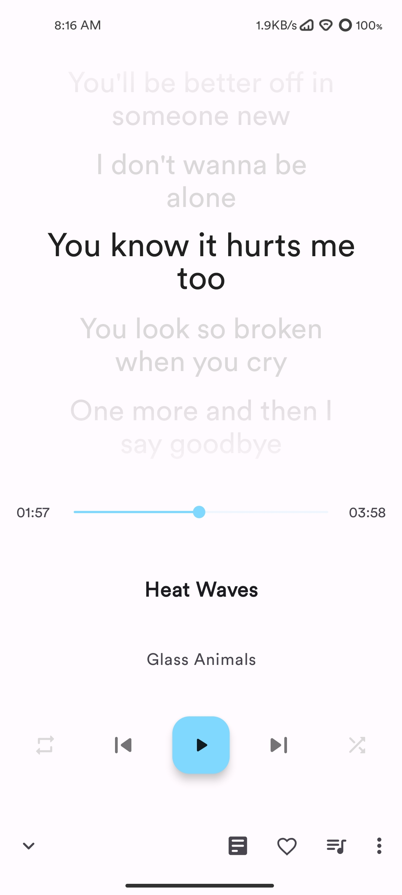
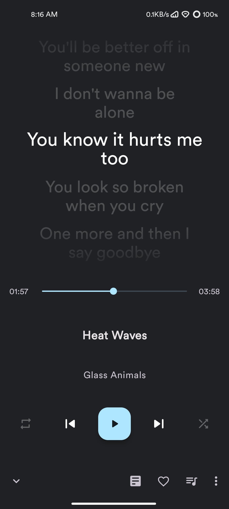
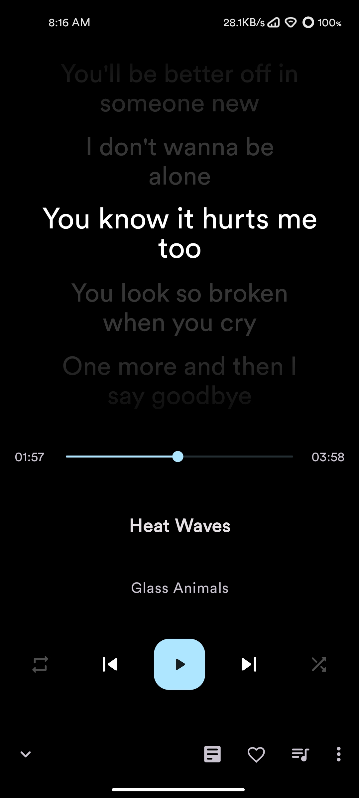
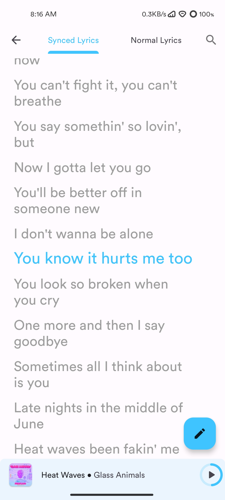
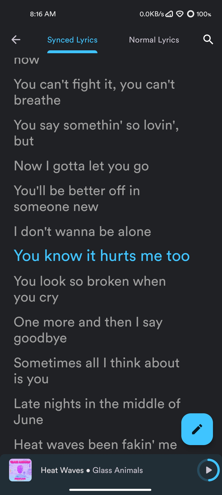
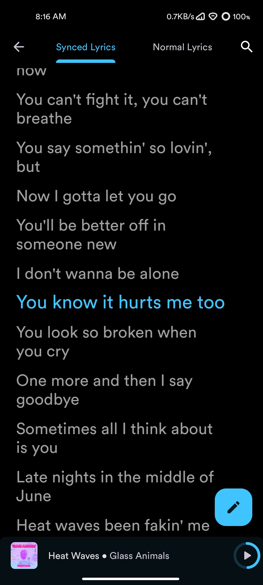

# RSOUNDS

**RSOUNDS** is an Android music player for local audio files, maintained by **riynkkazis**.

The app is based on the open-source Retro Music Player codebase. RSOUNDS keeps the upstream project's applicable license notices and attributions while maintaining its own app identity, settings and release documentation.

- **Application ID:** `app.riynk.rsounds`
- **Minimum Android version:** Android 7.0 (API 24)
- **Current version:** 1.0.1
- **Development branch:** `RSOUND`

## Build status

[](https://github.com/riynk/retro_music/actions/workflows/android-artifact.yml?query=branch%3ARSOUND)

Builds and downloadable artifacts are available from the [RSOUNDS GitHub Actions runs](https://github.com/riynk/retro_music/actions/workflows/android-artifact.yml?query=branch%3ARSOUND).

## Features

- Browse and play music stored on the device.
- Organize songs with playlists, albums, artists and folders.
- Multiple Now Playing layouts and album artwork effects.
- Synchronized lyrics with Replace Cover and Over Cover modes.
- Per-song lyric translation, with independent translation font, size and colour settings.
- Adjustable artwork dimming and 1–4 visible lyric lines in Over Cover mode.
- Themes, widgets, sleep timer, queue management and tag editing.
- Android Auto and Bluetooth/headset playback support.

RSOUNDS is a local music player. It does not provide music downloads or online streaming.

## Screenshots

### Synchronized lyrics — Over Cover

| Light | Dark | Black |
|:---:|:---:|:---:|
|  |  |  |

### Synchronized lyrics — Replace Cover

| Light | Dark | Black |
|:---:|:---:|:---:|
|  |  |  |

## Build from source

Use Java 21 and the Gradle wrapper included in this repository.

```bash
./gradlew :app:assembleNormalDebug
```

For the F-Droid flavour:

```bash
./gradlew :app:assembleFdroidDebug
```

The debug build uses a separate application ID suffix, but its launcher label is **RSOUNDS**.

## Bug reports and feature requests

Before opening an issue, check the [FAQ](FAQ.md) and search existing reports.

- [Report a bug](https://github.com/riynk/retro_music/issues/new?template=bug-report.yml)
- [Request a feature](https://github.com/riynk/retro_music/issues/new?template=feature-request.yml)

## Contact

- Telegram: [@riyankazis](https://t.me/riyankazis)
- Instagram: [@riynkk_](https://www.instagram.com/riynkk_/)
- Twitter: [@RiynkkAzis](https://twitter.com/RiynkkAzis)
- GitHub: [riynk](https://github.com/riynk)

## License

RSOUNDS is distributed under the GNU General Public License v3.0. See [LICENSE.md](LICENSE.md) and the copyright or license notices in individual source files and dependencies.

The original Retro Music Player project is credited as the upstream codebase; this repository does not claim ownership of upstream contributions.
